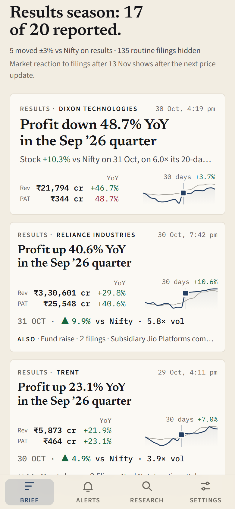
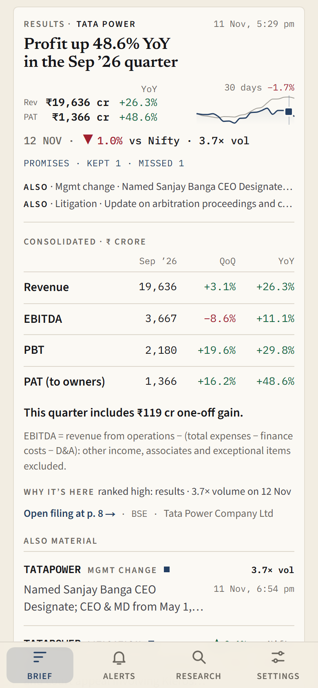
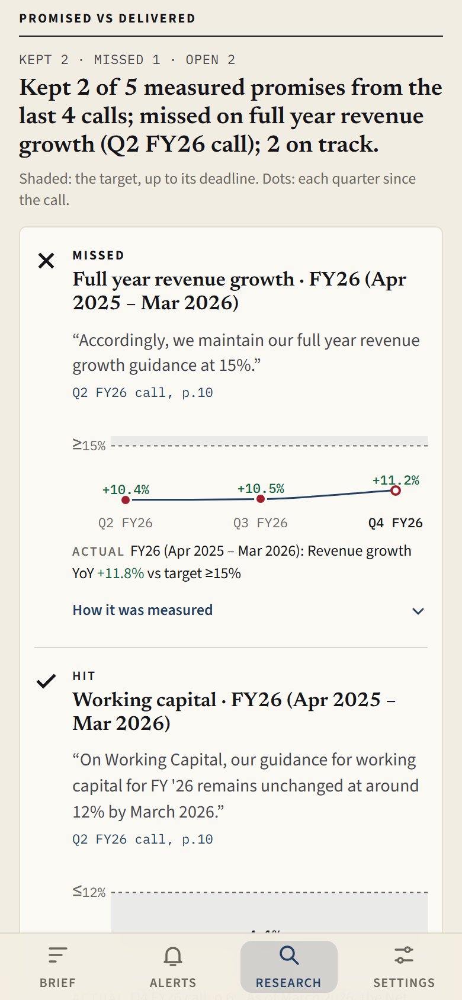
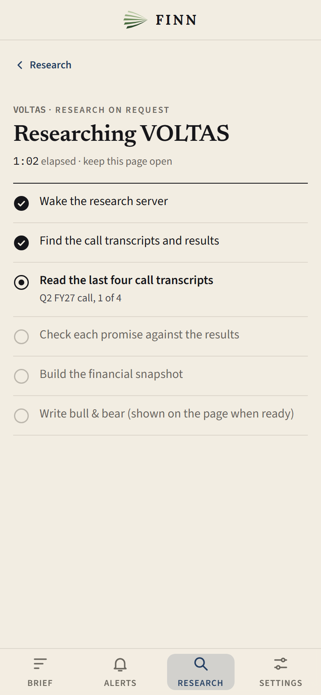

# FINN: a morning brief for a 20-stock Indian portfolio

[](https://github.com/Moksha4444/finn/actions/workflows/ci.yml)

> Investors aren't short of information, they're short of filtering. FINN hides the routine, ranks what the market
> reacted to, and asks whether management delivered what it promised.

**Live:** https://finn-coral-eta.vercel.app (mobile-first; on a desktop it shows a QR code for your phone)

**AI build history: [build-history/](build-history/)**: every Claude Code session that built FINN, in order
([index](build-history/sessions/INDEX.md)).

### Try it in 60 seconds

1. **Brief → This month.** Results season across the 20 holdings, ranked by what the market reacted to. Tap a story for
   the full results card (QoQ / YoY, one-offs flagged).
2. **Research → Larsen & Toubro.** FY26 revenue growth guidance was 15% ("we maintain our full year revenue growth
   guidance at 15%", Q2 FY26 call, p.10); delivered 11.8%: **missed**, with the quote and the page.
3. **Research → search HAVELLS** (or any NSE symbol not in the list) for a live run: the backend's stages tick off as a
   checklist, about 1–2 minutes.
4. **Settings → change a threshold** (say, move vs Nifty from ±3% to ±1.5%), then go back to the Brief and watch it re-rank.

FINN reads every exchange filing across a portfolio, hides the routine ones, and puts the few that matter at the top with
the numbers already worked out. For any NSE company it also checks whether management delivered what it promised on
its last four earnings calls. Every figure links to the filing or transcript page it came from.

Built for the ENAM Holdings AI Engineer build challenge (11–15 Nov 2026).

Screenshots of the live app (390×844, animations off), taken on 15 Nov 2026:

| Brief: this month | Results card, expanded | Promised vs Delivered (L&T) | Live research in progress |
|---|---|---|---|
|  |  |  |  |

## What it does

**Push: the Brief and Alerts**
- **Windowed digest** (24h / 7d / 30d) of filings for 20 holdings, ranked by materiality. Routine filings (investor
  meets, newspaper copies, postal ballots) are collapsed: "14 routine filings hidden". A quiet day says so.
- **Every rank explains itself.** A filing is boosted when the stock's reaction day crosses the user's thresholds:
  `Ranked high: results · −4.1% (−3.6% vs Nifty) · 2.3× volume`. Moves are measured against Nifty, not raw.
- **Alerts:** material (P1) filings in the categories you choose, EOD volume ≥ N× the 20-day average, and moves beyond
  ±X% vs Nifty. Thresholds live in Settings and re-rank the feed instantly, in the browser.
- **Rich cards:**
  - *Results:* Revenue, EBITDA, PBT, PAT (to owners) for this quarter, QoQ and YoY, in ₹ crore, consolidated where the
    filing allows (labelled either way). One-offs flagged ("Includes ₹119 cr one-off gain"). Banks and NBFCs show NII
    and total income instead of EBITDA.
  - *Management change:* who the person is, from the profile SEBI LODR requires in the filing itself, cited to its
    page. Only CEO / MD / CFO / Chairman changes are P1.
  - *Fund raise:* size and dilution, when the filing states them.
  - *Everything else:* a ≤12-word human headline at the right priority.
- **Promise record** on results stories ("PROMISES · KEPT 2 · MISSED 1") from the company's PvD record; nothing is shown when fewer than 2 promises are measured.

**Pull: Research, for any NSE symbol**
- **Promised vs Delivered (the hero):** guidance from the last 4 results-call transcripts, each promise with its quote
  and page, checked against later reported numbers. Verdicts: hit / miss / partial / not-yet-measurable, plus ahead /
  on track / behind pace while a period is still running, and moved closer / moved away for undated targets.
- **Financial snapshot:** 8 quarters of revenue and PAT, margin trend, 5-year cash conversion and debt/equity (lenders get
  total income and net margin instead).
- **Bull vs bear:** up to 3 points a side, each citing its evidence.
- 22 companies are precomputed (the portfolio plus ASTRAL and TITAN). Any other symbol runs live in ~1–2.5 minutes, with
  the backend's stages shown as a checklist.

## Architecture

```
GitHub Actions (08:37 + 18:37 IST)                     Vercel (static Next.js export, PWA)
  python -m finn.ingest --days 30                         reads web/public/data/*.json, ranks + alerts in the browser
    BSE API (NSE fallback) -> classify -> cards -> rank      │
    yfinance EOD prices + Nifty                              │ unresearched symbol
  -> web/public/data/feed.json, committed if changed ──────▶ │
                                                             ▼
python -m finn.pull.research (batch, by hand)          Render (FastAPI, free tier)
  screener.in -> transcripts + results filings            POST /research/{symbol} -> job id
  -> PvD, snapshot, bull/bear                             GET /jobs/{id} -> stage line ("Reading Q2 FY27 transcript (2/4)…")
  -> web/public/data/research/{SYMBOL}.json               same code as the batch; page cached on disk + in localStorage
```

- **Static-first.** The feed and the 22 research pages are JSON files on Vercel, so the app opens instantly even while
  Render is asleep. Render only serves live research for unseen symbols.
- **Rules before LLMs.** Classification is BSE subcategory → subject/headline keyword rules → the cheap model on pages 1–2
  only for generic subjects (about 1 filing in 50). Sizing rules (litigation < ₹1 cr, lenders' routine NCDs) are Python.
- **LLMs extract, Python computes.** Models copy printed numbers into strict JSON schemas; every growth rate, margin,
  EBITDA, dilution and verdict on a numeric promise is Python. Bull/bear points are dropped if any number in them isn't
  printed in their cited evidence, if the "why" is generic filler, or if they contradict a computed verdict. Points that fail get
  one repair round with the reasons.
- **Primary sources only on the pull side:** transcripts and the company's own results filings (screener.in's tables
  mirror the exchange filings and are cited as such). Prompts forbid outside knowledge; a missing fact is "not disclosed".
- **Nothing is hard-coded to a ticker.** NSE symbol → BSE scrip code / screener slug is resolved at run time.
- **A consistency gate** (`python -m finn.consistency`, also a test) checks that one fact has one number across the
  feed and every research page; the research batch fails if it doesn't. It caught ITC printing its year-ago column second, which had turned a −18.7% PAT change into −5.1%.

Code map: `backend/finn/` (`llm.py` router, `sources/` BSE/NSE/screener/prices/PDF, `push/` classify/cards/rank,
`pull/` PvD/segments/bank ratios/research, `api.py`, `ingest.py`), `web/` (Next.js app), `backend/tests/` (fixtures are
real filings).

## Model routing and cost

One router, `backend/finn/llm.py`, maps each task to a `provider:model` (overridable per task by env var). Every answer
is cached on disk keyed by (task, prompt text, schema, source-document hash), so editing a prompt invalidates exactly
the answers it affects. Every call logs tokens and cost at paid list prices.

| Tier | Model | Tasks |
|---|---|---|
| Cheap | Gemini 3.5 Flash-Lite → fallback Groq gpt-oss-20b | classify, results / bio / fund-raise / segment / balance-sheet extraction, guidance extraction, headlines |
| Strong | Groq gpt-oss-120b → fallback Gemini 3.8 Flash | promise verdicts (non-numeric ones only), bull/bear |
| Last resort | Gemini 3.5 Flash | live research only, when both strong models are down; labelled on the page |

Results PDFs go to the model as the 1–2 P&L pages only (~830 tokens vs ~12k for the whole PDF, and the only path that
reads scanned filings correctly; measured in DECISIONS.md).

**Total build cost: $3.21 at list prices for 974 model calls** (4.50M tokens in, 0.71M out; `cache/llm_calls.jsonl`),
plus about $0.15 for live-research runs on Render, which are logged on its own disk (a few cents more for the two runs
used for the screenshots above). All of it ran on free tiers, so actual spend was $0. Most of it ($2.13) was
re-extracting transcripts while the guidance prompt changed. Running costs: a cached re-run of all 22 research pages
costs about $0.01; a live research run for a new company costs about $0.02–0.05; a results card about $0.002.

## Run it locally

Needs Python 3.13 and Node 24+.

```bash
python -m venv .venv
.venv/Scripts/pip install -r backend/requirements.txt     # macOS/Linux: .venv/bin/pip
cp .env.example .env                                      # add GEMINI_API_KEY and GROQ_API_KEY (both free)

cd backend
../.venv/Scripts/python -m pytest -q                      # backend tests (live-LLM ones skip without keys)
../.venv/Scripts/python -m finn.ingest --days 30          # refresh the feed -> web/public/data/feed.json
../.venv/Scripts/python -m finn.pull.research TCS         # build one research page (any NSE symbol)
../.venv/Scripts/python -m uvicorn finn.api:app --reload  # live research API on :8000

cd ../web
npm ci && npm test
echo NEXT_PUBLIC_API_URL=http://localhost:8000 > .env.local   # optional: enables live research
npm run dev                                                   # http://localhost:3000
```

The LLM answer cache (`cache/llm/`) is committed, so re-running ingest or research on the committed data makes almost no
model calls. Downloaded filings (`cache/http/`) are not committed and are fetched again.

**Automation** (`.github/workflows/`): `ci.yml` runs backend + web tests and the static build on every push;
`ingest.yml` refreshes the feed twice a day and commits it only when the data changed (Vercel redeploys; Render's build
filter is `backend/**`, so it doesn't restart); `keep-warm.yml` pings Render's `/health` every ~10 minutes.

## Key decisions

Full log with the evidence for each: [DECISIONS.md](DECISIONS.md). The ones that shaped the product:
- **The company is the unit, not the filing.** One entry per company per window; a P1 that isn't the lead still shows as an
  "Also" line, so a CEO change can't hide under results.
- **Rank by market reaction too.** A filing the market moved on (vs Nifty) outranks a quiet one in the same tier.
- **PvD verdicts are computed, not judged,** wherever a number exists. Segment targets are measured on the filing's
  segment table, bank CD ratios on the balance sheet, and no target is called hit or missed before its period ends.
  On the first 22-company run 62% of promises were "not measurable"; now it's 36 of 72, and each one says why.
- **No letter grades.** An A–D grade for management was built and then removed: a letter from two measured promises is
  false precision. FINN prints the counts ("KEPT 1 · MISSED 1 · OPEN 1") and shows no record under 2 measured promises.
- **A thin, true section beats a full, generic one.** Bull/bear points that fail the checks are dropped, not padded.
- **No paid APIs, no database.** Free Gemini + Groq tiers with fallbacks; JSON files plus disk caches instead of
  SQLite/Supabase.
- **Cut on purpose:** web push (an in-app inbox and badge instead), business snapshot, tier editor, login, intraday data.

## Known limitations

- **Free-tier quotas.** Groq's gpt-oss-120b has a rolling ~200k-tokens-a-day cap, and Gemini's free tier has daily
  request caps. Live research is capped at 8 runs a day; on a quota day the fallback model answers and the page says
  so, or the run explains that the quota is used up.
- **Render cold starts.** The free instance sleeps after 15 idle minutes; waking takes 30–60 s ("Waking up the
  research server…"). The keep-warm ping makes this rare, but GitHub can delay scheduled runs.
- **Live research is remembered in two places only:** Render's disk (wiped on every restart or deploy) and the
  visitor's browser (localStorage). A company researched on one phone reopens instantly there, but not on another
  device after a restart. The 22 precomputed pages are permanent.
- **Daily data, not intraday.** Prices are EOD from yfinance, which posts bars late, so reactions can read "pending" until
  the next run.
- **Coverage gaps are shown, not hidden.** Scanned filings with no text layer get no results card (the raw filing link is
  shown). ITC and TRENT publish no call transcripts, so they have no promise record. Some US-dollar and volume targets
  can't be measured from Indian filings.
- **Sizing thresholds are flat** (fine for this all-large-cap portfolio; small caps would want market-cap-relative ones).
